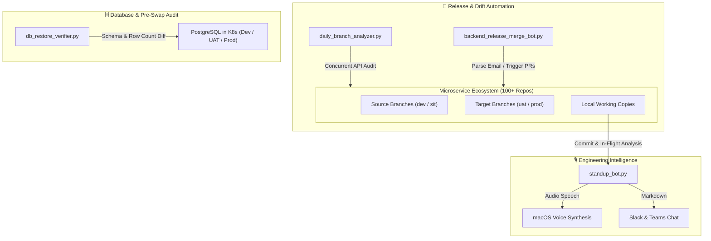

# 🛠️ Enterprise DevOps & Release Engineering Automation Suite

<p align="center">
  <strong>Production-tested automation bots for multi-repo Git release management, branch drift detection, database pre-swap verification, and engineering standup synthesis.</strong>
</p>

<p align="center">
  
  
  
  
  
  
</p>

---

## 📌 Suite Components

This repository contains four specialized DevOps automation engines developed to streamline multi-service release operations:

| Tool | Core Capability | Output Artifacts |
| :--- | :--- | :--- |
| **🔄 `daily_branch_analyzer.py`** | Multi-repo cross-organization branch drift detection & auto-sync | HTML, Markdown, and JSON drift reports |
| **🔀 `backend_release_merge_bot.py`** | Natural-language email parser & automated GitHub PR merge bot | Native GitHub PRs, conflict watchdog emails |
| **🗄️ `db_restore_verifier.py`** | 3-way schema and exact row-count database audit engine | Blue-Green pre-swap discrepancy reports |
| **🎙️ `standup_bot.py`** | Multi-repo commit synthesizer, spoken script (`say`) & Slack formatter | Spoken verbal script, Slack/Teams Markdown |
| **⏰ `setup_10am_cron.sh`** | Automated Unix cron scheduler for unattended execution | Scheduled system crontab entries |

---

## 🏗️ Architecture & Workflow



---

## 🧪 Proof of Work & Verification

All scripts in this repository have been validated through real-world runs and verified for execution reliability:

* **Detailed CLI Interface & Proofs**: See [proof-of-work/VERIFICATION_REPORT.md](proof-of-work/VERIFICATION_REPORT.md) for full execution logs.
* **CLI Help Proofs**:
  * [standup_bot_cli_help.txt](proof-of-work/standup_bot_cli_help.txt)
  * [daily_branch_analyzer_cli_help.txt](proof-of-work/daily_branch_analyzer_cli_help.txt)
  * [backend_release_merge_bot_cli_help.txt](proof-of-work/backend_release_merge_bot_cli_help.txt)
  * [db_restore_verifier_cli_help.txt](proof-of-work/db_restore_verifier_cli_help.txt)
* **Sample Live Execution**:
  * [standup_bot_sample_run.txt](proof-of-work/standup_bot_sample_run.txt)

---

## 🚀 Quickstart & Usage

### 1. Setup Environment
```bash
# Clone the repository
git clone https://github.com/Aniii-hub/Enterprise-DevOps-Release-Automation-Suite.git
cd Enterprise-DevOps-Release-Automation-Suite

# Configure environment variables
cp .env.example .env
# Fill in your GitHub PAT and notification settings in .env
```

### 2. Standup Bot (`standup_bot.py`)
Summarizes commits, branch activity, and modified files across repositories for your daily standup:
```bash
# Generate smart standup (covers yesterday or Friday-Monday automatically)
python3 standup_bot.py

# Speak the standup script aloud using macOS voice synthesis
python3 standup_bot.py --speak

# Copy Slack/Teams Markdown directly to clipboard
python3 standup_bot.py --copy
```

### 3. Branch Drift Analyzer (`daily_branch_analyzer.py`)
Scans repository pairs concurrently, flags discrepancies, and outputs executive reports:
```bash
python3 daily_branch_analyzer.py --output-dir reports
```

### 4. Release Merge Bot (`backend_release_merge_bot.py`)
Parses release emails or explicit service arguments to execute clean PR merges:
```bash
# Dry-run merge validation
python3 backend_release_merge_bot.py --src dev --tgt uat --services Core-Service Inventory-Service --dry-run
```

### 5. Database Pre-Swap Verifier (`db_restore_verifier.py`)
Validates schema columns and exact row counts before performing Blue/Green database cutovers:
```bash
python3 db_restore_verifier.py --mode compare --src uat --tgt prod --db AppDB AccountsDB
```

---

## 🔒 Security Standards

* **Zero Hardcoded Secrets**: All tokens, database passwords, and API credentials are read from standard environment variables (`.env`).
* **Sanitized Default Configs**: Template presets use generic placeholders (`devops@example.com`, `~/.kube/config`).
* **Non-Destructive Simulation**: All release and database operations support dry-run flags (`--dry-run`) to guarantee safety.

---

## 📄 License

This repository is licensed under the [MIT License](LICENSE).
